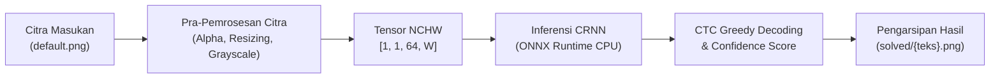

# End-to-End Visual Text Recognition on Distortion-Resistant CAPTCHA v1 using CRNN and CTC Decoding
### Pipeline OCR Mandiri & Ringan untuk Evaluasi Ketahanan Sistem Verifikasi Teks

[](https://www.python.org/)
[](https://onnxruntime.ai/)
[](LICENSE.md)
[](docs/THEORY.md)

---

## 📌 Ringkasan Proyek (Overview)

Repositori ini menyajikan implementasi mandiri (*standalone*) dari sistem pengenalan karakter visual berbasis *Deep Learning* untuk membedah dan mengenali teks terdistorsi pada sistem **CAPTCHA v1**. Menggunakan arsitektur terpadu **Convolutional Recurrent Neural Network (CRNN)** dan algoritma penguraian **Connectionist Temporal Classification (CTC) Greedy Decoding**, sistem ini mampu mengenali urutan karakter tanpa membutuhkan segmentasi fisik per huruf.

Pipeline ini dirancang seringan mungkin (*lightweight production-ready inference*):
* **Bebas Dependensi Berat**: Tidak memerlukan kerangka kerja masif seperti PyTorch (~2.5 GB) atau TensorFlow (~500 MB) pada tahap inferensi. Seluruh komputasi berjalan independen menggunakan **ONNX Runtime** teroptimasi pada CPU.
* **Alur Bisnis Otomasi Mandiri**: Mengintegrasikan pra-pemrosesan citra digital, inferensi graf jaringan saraf, dekoding sekuens, kalkulasi metrik kepastian (*confidence score*), hingga pengarsipan berkas hasil secara atomik.

> 📖 **Dokumentasi Teori Lengkap**: Penurunan rumus matematika Visi Komputer, formulasi CTC NLP, serta analisis mendalam keamanan siber tersedia pada [**Kajian Teori Akademik (`docs/THEORY.md`)**](docs/THEORY.md).

---

## ⚙️ Diagram Alur Pipeline (Workflow)



---

## 📂 Struktur Repositori

```text
├── standalone_ocr_tutorial.ipynb   # Notebook tutorial interaktif langkah demi langkah (Langkah 0 s/d 12)
├── standalone_ocr.py               # Skrip modul Python produksi siap pakai (CLI & Importable Module)
├── model.onnx                      # Bobot teroptimasi model CRNN dalam format ONNX (~13 MB)
├── solved/                         # Direktori arsip berkas citra yang berhasil dipecahkan
├── docs/
│   └── THEORY.md                   # Kajian komprehensif teori S2 (Visi Komputer, NLP, Cyber Security)
├── README.md                       # Dokumentasi utama repositori
└── LICENSE.md                      # Lisensi terbatas akademik & ketentuan non-komersial
```

---

## 🚀 Panduan Penggunaan & Spesifikasi Dependensi (Quick Start)

### 1. Kebutuhan Lingkungan & Penjelasan Modul
Proyek ini membutuhkan **Python 3.8+** dengan dependensi minimal tanpa *framework* berat. Setiap modul memiliki peran spesifik:

| Modul / Pustaka | Peran Teknis dalam Pipeline |
| :--- | :--- |
| **`numpy`** | Operasi aljabar linear, manipulasi matriks piksel, normalisasi skala numerik $[0.0, 1.0]$, serta penataan dimensi tensor 4D NCHW. |
| **`Pillow` (PIL)** | Pembacaan dan penyimpanan berkas citra digital, operasi *alpha channel blending*, konversi ruang warna (*grayscale*), dan *resampling* spasial bilinier. |
| **`onnxruntime`** | Mesin inferensi berkinerja tinggi untuk mengeksekusi graf komputasi model *neural network* (CRNN) secara langsung pada CPU tanpa PyTorch/TensorFlow. |
| **`matplotlib`** | Pembuatan visualisasi analitis pada Jupyter Notebook (inspeksi citra sebelum/sesudah pra-pemrosesan dan histogram distribusi piksel). |

Instal seluruh pustaka yang diperlukan sekaligus:
```bash
pip install numpy Pillow onnxruntime matplotlib
```

---

### 2. Aturan Penempatan Berkas Citra Masukan (PENTING)
Sebelum mengeksekusi kode, **letakkan berkas citra CAPTCHA yang ingin diuji di dalam direktori yang sama (sejajar)** dengan berkas notebook atau skrip Python:

```text
c:/.../project/
├── model.onnx
├── standalone_ocr_tutorial.ipynb   <-- Berkas Jupyter Notebook
├── standalone_ocr.py               <-- Berkas Skrip Python
├── default.png                     <-- LETAKKAN BERKAS CITRA DI SINI (SEJAJAR)
└── solved/                         <-- Folder arsip hasil (dibuat otomatis)
```

> **Catatan Alur Berkas Fisik**:
> * Nama berkas masukan *default* adalah **`default.png`**.
> * Jika berkas `default.png` belum diletakkan di samping notebook, notebook akan menampilkan pesan peringatan ramah (*file not found*) tanpa memicu *system crash*.
> * Setelah proses inferensi berhasil, sistem akan **secara otomatis menyalin dan menamai ulang** berkas tersebut ke dalam folder arsip: `solved/{hasil_teks}.png`, kemudian menghapus berkas `default.png` lama di direktori kerja untuk menjaga kebersihan direktori (*directory hygiene*) dan mencegah siklus pemrosesan ganda.

---

### 3. Menjalankan Tutorial Interaktif (Jupyter Notebook)
Gunakan notebook ini untuk mempelajari alur pra-pemrosesan citra, inferensi ONNX, dan mekanisme *CTC Greedy Decoding* langkah demi langkah:
```bash
jupyter notebook standalone_ocr_tutorial.ipynb
```
1. Pastikan berkas `default.png` sudah ada di folder yang sama dengan notebook.
2. Buka notebook dan jalankan sel dari **Langkah 0** hingga **Langkah 12** secara berurutan.
3. Amati proses visualisasi pada setiap tahap pra-pemrosesan serta penelusuran (*tracing*) decoding CTC.

---

### 4. Menjalankan Skrip Produksi Mandiri (CLI)
Anda juga dapat mengeksekusi inferensi langsung dari terminal / baris perintah:
```bash
# Memproses berkas default.png yang berada sejajar di direktori kerja
python standalone_ocr.py

# Atau memproses berkas citra spesifik dari jalur lain
python standalone_ocr.py path/to/nama_gambar.png
```

---

## 🔬 Landasan Ilmiah & Aspek Riset

| Ranah Keilmuan | Konsep yang Diterapkan | Rujukan Teori |
| :--- | :--- | :--- |
| **Visi Komputer** | Normalisasi Alpha Blending, Bilinear Aspect-Ratio Resizing ($H=64$), Reduksi Warna ITU-R BT.601, Min-Max Normalization $[0.0, 1.0]$, Topologi Tensor NCHW. | [Kajian Teori Bagian 1](docs/THEORY.md#1-landasan-visi-komputer-computer-vision) |
| **Advanced NLP** | *Alignment-free sequence learning*, Connectionist Temporal Classification (CTC Greedy Decoding), Eliminasi Blank Token ($\epsilon$), Charset 8.210 entri, *Confidence Score*. | [Kajian Teori Bagian 2](docs/THEORY.md#2-advanced-nlp--pemodelan-sekuens-temporal-sequence-modeling) |
| **Deep Learning** | Arsitektur CRNN (CNN + BiLSTM), Stabilitas Numerik Softmax (*Max-Subtraction trick*), Akselerasi Inferensi CPU via ONNX Runtime. | [Kajian Teori Bagian 3](docs/THEORY.md#3-arsitektur-deep-learning--rekayasa-inferensi-crnn--onnx) |
| **Keamanan Siber** | Evaluasi ketahanan Uji Turing Publik (CAPTCHA v1), vektor ancaman otomasi (*credential stuffing*, *unauthorized scraping*), evolusi pertahanan verifikasi modern (v2/v3, Turnstile, WebAuthn). | [Kajian Teori Bagian 4](docs/THEORY.md#4-analisis-keamanan-siber-runtuhnya-paradigma-captcha-v1) |

---

## 🤝 Atribusi Sumber Daya Eksternal (Attribution)

Penyusunan proyek ini menjunjung tinggi orisinalitas dan etika riset dengan memberikan penghargaan kepada karya sumber terbuka terdahulu:
* **Bobot Model Jaringan Saraf & Basis Charset**: Diadopsi dan diekstrak dari repositori *open-source* **[ddddocr](https://github.com/sml2h3/ddddocr)** karya pengembang **sml2h3** (dirilis di bawah lisensi MIT).
* **Mesin Inferensi Graf**: Didukung oleh mesin berkinerja tinggi **[ONNX Runtime](https://github.com/microsoft/onnxruntime)** karya Microsoft Corporation.
* **Sitasi Ilmiah Utama**:
  * *Shi, B., Bai, X., & Yao, C. (2015). An End-to-End Trainable Neural Network for Image-based Sequence Recognition and Its Application to Scene Text Recognition. IEEE TPAMI.*
  * *Graves, A., Fernández, S., Gomez, F., & Schmidhuber, J. (2006). Connectionist Temporal Classification: Labelling Unsegmented Sequence Data with Recurrent Neural Networks. ICML.*
  * *von Ahn, L., Blum, M., Hopper, N. J., & Langford, J. (2003). CAPTCHA: Using Hard AI Problems for Security. EUROCRYPT.*

---

## ⚖️ Lisensi & Ketentuan Terbatas Non-Komersial

Proyek dan kode ini dilindungi di bawah **Lisensi Riset Akademik dan Non-Komersial** (lihat [**`LICENSE.md`**](LICENSE.md)).

1. **Terbatas untuk Kepentingan Riset & Edukasi**: Proyek ini dikembangkan secara eksklusif sebagai studi ilmiah, pengujian ketahanan sistem (*security evaluation*), serta eksplorasi pemodelan sekuensial pada representasi teks visual.
2. **Dilarang untuk Penggunaan Komersial**: Tidak diperkenankan untuk diperjualbelikan, dimonetisasi, atau dimasukkan ke dalam produk/layanan komersial berbayar.
3. **Pernyataan Penggunaan Etis (*Responsible AI & Anti-Abuse*)**: Kode ini ditujukan murni sebagai bahan kajian evaluasi ketahanan sistem pertahanan informasi (*defensive research*). Dilarang keras digunakan untuk tindakan ilegal, seperti pembobolan sistem (*brute-force*), penarikan data tanpa izin (*unauthorized web scraping*), atau pelanggaran Ketentuan Layanan (*Terms of Service*) dari platform web publik mana pun.
